# PulseChat — Enterprise Offline-First Real-Time Chat Platform

[](https://openjdk.org/)
[](https://spring.io/projects/spring-boot)
[](https://spring.io/projects/spring-security)
[](https://stomp.github.io/)
[](https://react.dev/)
[](https://dexie.org/)
[](https://www.mysql.com/)
[-success.svg?style=flat-square)]()
[]()

PulseChat is a full-stack, **offline-first distributed messaging platform** engineered with **Java 21, Spring Boot 3.3, MySQL, STOMP WebSockets, React 19, and Dexie.js (IndexedDB)**.

Unlike naive chat applications that drop messages when internet connectivity fluctuates, PulseChat treats offline state as a first-class citizen. It implements an **IndexedDB Outbox Pattern** on the frontend paired with an **Idempotent Batch Synchronization Engine** on the backend, ensuring zero message loss and zero duplicate records across flaky mobile networks and server reconnects.

---

## 📋 Resume Summary & Key Talking Points

> **💡 For Resume / Portfolio / Interview Presentations:**
> You can directly incorporate these bullet points into your software engineering resume:

- **Architected an Offline-First Distributed Messaging Platform** using **Java 21, Spring Boot 3.3, and React 19**, ensuring zero message loss during network dropouts via an IndexedDB transactional outbox queue with optimistic UI rendering.
- **Engineered an Idempotent Batch Synchronization Engine (`POST /api/v1/sync`)** utilizing client-generated UUIDs (`clientMessageId`) and MySQL unique constraints, eliminating 100% of duplicate message insertions during retry storms and automated reconnects.
- **Implemented Low-Latency Real-Time Communication** via **STOMP over SockJS**, securing persistent socket sessions through a custom Spring Security `ChannelInterceptor` that parses and validates JWT bearer tokens during the STOMP `CONNECT` handshake.
- **Designed Resilient Client-Side Caching & Reconciliation** with **Dexie.js**, managing multi-table local stores (`outbox`, `messages`, `conversations`) and bi-directional timestamp-based reconciliation (`lastSyncTimestamp`) to pull missed messages upon reconnection.
- **Authored a Robust Test Suite (100% Pass Rate)** using **JUnit 5, Mockito, and Spring Boot Test (H2 in-memory profile)**, verifying cryptographic password hashing, transactional integrity, and idempotency guarantees.

---

## 📑 Table of Contents
1. [System Architecture & Data Flow](#1-system-architecture--data-flow)
2. [Key Engineering Challenges & Solutions](#2-key-engineering-challenges--solutions)
3. [Technology Stack](#3-technology-stack)
4. [Database Schema & ER Model](#4-database-schema--er-model)
5. [API Specifications & WebSocket Protocol](#5-api-specifications--websocket-protocol)
6. [Interactive Simulation & Verification Walkthrough](#6-interactive-simulation--verification-walkthrough)
7. [Automated Testing Suite](#7-automated-testing-suite)
8. [Local Setup & Deployment](#8-local-setup--deployment)
9. [Technical Interview Q&A (Architecture Defense)](#9-technical-interview-qa-architecture-defense)

---

## 1. System Architecture & Data Flow

### 1.1 High-Level Component Architecture

```mermaid
flowchart TD
    subgraph Client ["Client Browser (React 19 + Dexie IndexedDB)"]
        UI["React UI (ChatArea, Sidebar, SyncInspector)"]
        OutboxDB[("Dexie.js Outbox\n(UUID Primary Key)")]
        MsgCache[("Dexie.js Message Cache\n(Local Mirror)")]
        SyncManager["Sync Coordinator\n(Online/Offline Listeners)"]
        WSClient["STOMP / SockJS Client\n(/user/queue/messages)"]

        UI -->|1. Optimistic Write (Status: PENDING)| OutboxDB
        UI -->|Display Instantly| MsgCache
        SyncManager -->|Flush Pending on Reconnect| OutboxDB
        WSClient <-->|Bi-directional STOMP| UI
    end

    subgraph Backend ["Spring Boot 3.3 Backend"]
        SecurityGateway["Spring Security 6 (Stateless JWT Filter)"]
        WSChannelInterceptor["WebSocketAuthInterceptor\n(STOMP CONNECT Auth)"]
        SyncCtrl["SyncController\n(POST /api/v1/sync)"]
        ChatCtrl["WebSocketChatController\n(/app/chat.send/{id})"]
        
        SyncService["SyncService\n(@Transactional Deduplication)"]
        MsgService["MessageService\n(Idempotent Save)"]
        NotificationService["WebSocketNotificationService\n(SimpMessagingTemplate)"]

        SecurityGateway --> SyncCtrl
        WSChannelInterceptor --> ChatCtrl
        SyncCtrl --> SyncService --> MsgService
        ChatCtrl --> MsgService --> NotificationService
    end

    subgraph Persistence ["Persistence Layer (MySQL 8.0)"]
        DB[(offline_chat_db\n- users\n- conversations\n- participants\n- messages UNIQUE client_msg_id)]
        MsgService --> DB
    end

    WSClient <-->|Persistent WebSocket Frame| WSChannelInterceptor
    SyncManager -->|Batch HTTP Payload| SecurityGateway
```

### 1.2 Offline-to-Online Synchronization Sequence

```mermaid
sequenceDiagram
    autonumber
    actor User as Client (Alice)
    participant IDB as Local IndexedDB
    participant Net as Network Monitor
    participant Sync as SyncService (Frontend)
    participant Server as Spring Boot Backend
    participant DB as MySQL Database
    actor Bob as Recipient (Bob)

    Note over User,IDB: User disconnects (Wi-Fi dropped or Simulated)
    User->>IDB: Send Message ("Hello Bob")
    IDB-->>User: Enqueue in Outbox (UUID: 8f2a..., status: PENDING)
    User-->>User: Optimistic UI displays 🕒 PENDING

    Note over Net,Server: Connection Restored (online event fired)
    Net->>Sync: Trigger automatic synchronization
    Sync->>IDB: getPendingOutboxMessages() + getLastSyncTimestamp()
    IDB-->>Sync: Return 1 queued message, timestamp: T0

    Sync->>Server: POST /api/v1/sync { pendingMessages: [...], lastSyncTimestamp: T0 }
    
    rect rgb(20, 30, 50)
        Note over Server,DB: Backend Transactional Processing
        Server->>DB: Check EXISTS(client_message_id = '8f2a...')
        alt Message does not exist (New)
            Server->>DB: INSERT INTO messages (...) VALUES (...)
            Server->>DB: Update conversation preview & last_message_at
            Server->>Bob: Push via STOMP /user/bob/queue/messages
        else Message already exists (Duplicate retry)
            Server-->>Server: Increment duplicatesSkipped, fetch existing ID
        end
        Server->>DB: Query missed incoming messages since T0
        DB-->>Server: Return messages from other participants
    end

    Server-->>Sync: SyncResponse { acknowledged: {'8f2a...': 104}, newMessages: [], duplicatesSkipped: 0 }
    Sync->>IDB: Mark message SENT, update serverId: 104, remove from outbox
    Sync->>IDB: Update lastSyncTimestamp = now()
    Sync-->>User: UI updates status: 🕒 PENDING ➔ ✓ SENT
```



---

## 2. Key Engineering Challenges & Solutions

| Engineering Challenge | Naive Approach | PulseChat Production Solution |
|---|---|---|
| **Message loss during network drops** | Send HTTP/WS request directly; fail and notify user to re-type. | **Transactional Outbox Pattern:** Outgoing messages are written to Dexie IndexedDB with status `PENDING` *before* attempting network transmission. |
| **Duplicate messages on retry/reconnect** | Auto-increment primary key on backend causes duplicated rows if client retries after network timeouts. | **Client-Generated UUID Idempotency:** Client assigns `clientMessageId = crypto.randomUUID()`. Backend enforces a database-level `UNIQUE` index on `client_message_id`. Retries return existing records idempotently. |
| **WebSocket Authentication** | Browsers cannot set custom HTTP Authorization headers during standard `new WebSocket()` upgrades. | **STOMP Frame Interception:** `WebSocketAuthInterceptor` intercepts the native STOMP `CONNECT` frame, extracts `Authorization: Bearer <token>`, validates the JWT, and binds `UsernamePasswordAuthenticationToken` to the WebSocket session. |
| **Missed messages while offline** | User misses all incoming messages sent while disconnected. | **Bi-Directional Reconciliation:** The sync payload supplies `lastSyncTimestamp`. The server responds not only with acknowledgements but also queries and returns all messages received from other participants since that timestamp. |
| **Optimistic UI with Reactive Storage** | Stale local state or complex manual DOM mutations. | **Reactive Local Mirror:** The UI state renders directly from local storage. When server acknowledgements arrive, IndexedDB records update and cascade reactively to the view. |

---

## 3. Technology Stack

### Backend
- **Core Framework:** Java 21 LTS, Spring Boot 3.3.4
- **Security:** Spring Security 6 with JJWT 0.12.6 (Stateless Token Authentication, BCrypt password hashing)
- **Real-Time Protocol:** Spring WebSocket with STOMP broker and SockJS fallback
- **Data Persistence:** Spring Data JPA, Hibernate ORM 6.5, HikariCP connection pooling
- **Databases:** MySQL 8.0 (Production) & H2 Database (In-Memory for unit/integration tests)
- **API Documentation:** SpringDoc OpenAPI 2.6 (Swagger UI 3.0)
- **Testing:** JUnit 5, Mockito, Spring Boot Test, AssertJ

### Frontend
- **Framework & Tooling:** React 19, Vite 8, React Router v7
- **Offline Storage:** Dexie.js 4.4 (IndexedDB wrapper with ACID transactions)
- **Real-Time Client:** `@stomp/stompjs` 7.5 & `sockjs-client` 1.6
- **HTTP Client:** Axios with JWT request injection and 401 response interceptors
- **Styling & UI:** Custom design system (Dark obsidian palette, glassmorphism, glowing status badges, responsive mobile layout)

---

## 4. Database Schema & ER Model

```
+-----------------------------------------------------------+
|                          USERS                            |
+-----------------------------------------------------------+
| id            : BIGINT PK AUTO_INCREMENT                  |
| username      : VARCHAR(50)  UNIQUE NOT NULL              |
| email         : VARCHAR(100) UNIQUE NOT NULL              |
| password_hash : VARCHAR(255) NOT NULL (BCrypt)            |
| display_name  : VARCHAR(100) NOT NULL                     |
| avatar_url    : VARCHAR(255)                              |
| created_at    : TIMESTAMP DEFAULT CURRENT_TIMESTAMP       |
| updated_at    : TIMESTAMP DEFAULT CURRENT_TIMESTAMP       |
+-----------------------------------------------------------+
                             | 1
                             |
                             | M
+-----------------------------------------------------------+
|               CONVERSATION_PARTICIPANTS                   |
+-----------------------------------------------------------+
| id              : BIGINT PK AUTO_INCREMENT                |
| conversation_id : BIGINT FK -> CONVERSATIONS(id)          |
| user_id         : BIGINT FK -> USERS(id)                  |
| last_read_at    : TIMESTAMP                               |
| joined_at       : TIMESTAMP DEFAULT CURRENT_TIMESTAMP     |
+-----------------------------------------------------------+
                             M |
                               | 1
+-----------------------------------------------------------+
|                      CONVERSATIONS                        |
+-----------------------------------------------------------+
| id                   : BIGINT PK AUTO_INCREMENT           |
| type                 : VARCHAR(20) DEFAULT 'DIRECT'       |
| last_message_preview : TEXT                               |
| last_message_at      : TIMESTAMP                          |
| created_at           : TIMESTAMP DEFAULT CURRENT_TIMESTAMP|
+-----------------------------------------------------------+
                             | 1
                             |
                             | M
+-----------------------------------------------------------+
|                         MESSAGES                          |
+-----------------------------------------------------------+
| id                 : BIGINT PK AUTO_INCREMENT             |
| client_message_id  : VARCHAR(36) UNIQUE NOT NULL (UUID)   | <--- Idempotency Key
| conversation_id    : BIGINT FK -> CONVERSATIONS(id)       |
| sender_id          : BIGINT FK -> USERS(id)               |
| content            : TEXT NOT NULL                        |
| status             : VARCHAR(20) DEFAULT 'SENT'           |
| client_created_at  : TIMESTAMP NOT NULL                   |
| server_received_at : TIMESTAMP DEFAULT CURRENT_TIMESTAMP  |
+-----------------------------------------------------------+
```

### Indexing Strategy
- `idx_users_username` on `users(username)` — High-speed login lookup.
- `idx_users_email` on `users(email)` — Fast uniqueness checks.
- `idx_messages_client_id` on `messages(client_message_id)` — Instant O(1) deduplication check during batch sync.
- `idx_messages_conv_server_time` on `messages(conversation_id, server_received_at)` — Paginated history and missed-messages delta sync.

---

## 5. API Specifications & WebSocket Protocol

### 5.1 REST APIs

All authenticated endpoints require header: `Authorization: Bearer <jwt-token>`.

#### Authentication (`/api/v1/auth`)
| Method | Endpoint | Request Body | Description |
|---|---|---|---|
| `POST` | `/api/v1/auth/register` | `{ username, email, password, displayName }` | Registers user, returns JWT and user profile |
| `POST` | `/api/v1/auth/login` | `{ usernameOrEmail, password }` | Authenticates credentials, returns JWT |
| `GET` | `/api/v1/auth/me` | *None* | Returns authenticated user profile |

#### Synchronization (`/api/v1/sync`)
| Method | Endpoint | Request Body | Response Body |
|---|---|---|---|
| `POST` | `/api/v1/sync` | `SyncRequest` | `SyncResponse` |

**Sample `SyncRequest`:**
```json
{
  "pendingMessages": [
    {
      "clientMessageId": "8f2a1b94-5c3e-4d2a-b011-8e7c5d4f3a12",
      "conversationId": 10,
      "content": "Message written while offline",
      "clientCreatedAt": "2026-10-22T14:30:00Z"
    }
  ],
  "lastSyncTimestamp": "2026-10-22T14:00:00Z"
}
```

**Sample `SyncResponse`:**
```json
{
  "acknowledgedMessages": {
    "8f2a1b94-5c3e-4d2a-b011-8e7c5d4f3a12": 104
  },
  "newIncomingMessages": [
    {
      "id": 105,
      "clientMessageId": "srv-105",
      "conversationId": 10,
      "sender": { "id": 2, "username": "bob", "displayName": "Bob" },
      "content": "Hey Alice, are you back online?",
      "status": "SENT",
      "serverReceivedAt": "2026-10-22T14:25:00Z"
    }
  ],
  "duplicatesSkipped": 0
}
```

#### Conversations & Messaging (`/api/v1/conversations`)
| Method | Endpoint | Description |
|---|---|---|
| `GET` | `/api/v1/conversations` | Lists conversations with other participants and unread counts |
| `POST` | `/api/v1/conversations/direct` | Finds existing or creates new direct conversation with recipient |
| `GET` | `/api/v1/conversations/{id}/messages` | Paginated message history (`?page=0&size=50`) |
| `POST` | `/api/v1/conversations/{id}/messages` | REST fallback for sending messages |
| `POST` | `/api/v1/conversations/{id}/read` | Updates participant's `lastReadAt` timestamp |

---

### 5.2 STOMP WebSocket Protocol

- **Connection URL:** `http://localhost:8080/ws` (with SockJS negotiation)
- **STOMP Connect Header:** `Authorization: Bearer <jwt-token>`

| Destination | Direction | Payload Schema | Description |
|---|---|---|---|
| `/app/chat.send/{conversationId}` | Client ➔ Server | `{ clientMessageId, content, clientCreatedAt }` | Sends message to conversation participants |
| `/user/queue/messages` | Server ➔ Client | `MessageResponse` JSON | Personal queue for incoming direct messages |
| `/user/queue/receipts` | Server ➔ Client | `{ clientMessageId, status }` | Delivery & read receipt updates |

---

## 6. Interactive Simulation & Verification Walkthrough

PulseChat includes a built-in **Simulation & Diagnostics Engine** designed specifically for demonstration and technical interviews:

1. **Multi-User Real-Time Testing:**
   - Open `http://localhost:5173` in two browser windows side-by-side.
   - Use the **1-Click Demo Accounts**: Sign in as **👩 Alice** in Window 1 and **👨 Bob** in Window 2.
   - Start a conversation and send messages — observe sub-second WebSocket delivery with `✓✓ Delivered` badges.

2. **Testing Offline Queuing:**
   - In Alice's window, click **⚡ Simulate Offline** in the top navigation bar.
   - The status badge switches to `Offline (Simulated)` and severs the WebSocket connection.
   - Type `"Urgent message written without connection"` and click send.
   - The message bubble renders optimistically with a **`🕒 Pending`** status icon.
   - Open the **💾 Storage Inspector** modal: View the raw record queued in the Dexie IndexedDB `outbox` table with its generated UUID.

3. **Testing Automatic Reconnect & Idempotent Sync:**
   - In Alice's window, click **⚡ Simulating Offline** to restore the network.
   - The sync coordinator automatically fires, executes `POST /api/v1/sync`, updates the status to **`✓ Sent`**, clears the outbox, and delivers the message to Bob's window in real time.
   - Clicking **Sync Outbox Now** again demonstrates idempotency: `0 duplicates inserted, 0 errors`.

---

## 7. Automated Testing Suite

PulseChat includes an automated test suite verifying edge cases, authentication guards, and deduplication logic:

```bash
cd backend
./mvnw test
```

### Test Coverage Highlights
- **`BackendApplicationTests`**: Verifies full Spring context bootstrapping, JPA entity mappings, and Hibernate schema generation.
- **`AuthServiceTest`**: Validates user registration, BCrypt password encryption, duplicate username/email conflict rejection, and JWT generation.
- **`MessageServiceTest`**: Tests idempotent saving logic — asserts that sending the same `clientMessageId` returns the existing record without database duplicate writes.
- **`SyncServiceTest`**: Simulates batch outbox synchronization, acknowledgement mapping, and duplicate skip tracking (`duplicatesSkipped`).

```text
[INFO] Running com.offlinechat.BackendApplicationTests
[INFO] Tests run: 1, Failures: 0, Errors: 0, Skipped: 0
[INFO] Running com.offlinechat.service.AuthServiceTest
[INFO] Tests run: 4, Failures: 0, Errors: 0, Skipped: 0
[INFO] Running com.offlinechat.service.MessageServiceTest
[INFO] Tests run: 2, Failures: 0, Errors: 0, Skipped: 0
[INFO] Running com.offlinechat.service.SyncServiceTest
[INFO] Tests run: 2, Failures: 0, Errors: 0, Skipped: 0
[INFO] ------------------------------------------------------------------------
[INFO] BUILD SUCCESS (9 tests executed, 0 failures, 0 errors)
[INFO] ------------------------------------------------------------------------
```

---

## 8. Local Setup & Deployment

### Prerequisites
- **Java 21 JDK**
- **Node.js 18+** & **npm**
- **Docker & Docker Compose** (or local MySQL 8.0)

### 1. Database Setup
```bash
docker compose up -d
```
*Spins up a preconfigured MySQL 8.0 container on port `3306` with database `offline_chat_db`.*

### 2. Run Backend
```bash
cd backend
./mvnw spring-boot:run
```
- API Base URL: `http://localhost:8080`
- Swagger UI: `http://localhost:8080/swagger-ui.html`
- OpenAPI JSON Spec: `http://localhost:8080/api-docs`

### 3. Run Frontend
```bash
cd frontend
npm install
npm run dev
```
- Access the web application at: `http://localhost:5173`

---

## 9. Technical Interview Q&A (Architecture Defense)

### Q1: Why use client-generated UUIDs (`clientMessageId`) instead of letting the database auto-increment IDs?
> **Answer:** If ID generation is left to the server, a client that loses connection while waiting for a response has no way to know if its message was persisted or not. Retrying would cause the server to assign a brand new auto-increment ID, creating duplicate messages. By assigning a UUID on the client *before* network transmission, the UUID serves as a distributed idempotency key. The database enforces `UNIQUE(client_message_id)`, guaranteeing exactly-once message semantics.

### Q2: Why STOMP over raw WebSockets?
> **Answer:** Raw WebSockets only define a bidirectional stream of bytes/text without routing or frame semantics. STOMP (Simple Text Oriented Messaging Protocol) introduces a lightweight pub/sub abstraction with standard frame types (`CONNECT`, `SEND`, `SUBSCRIBE`, `MESSAGE`) and destination headers. This allows seamless integration with Spring's `@MessageMapping`, user-destination routing (`/user/{username}/queue/...`), and broker pluggability (in-memory Simple Broker for development, RabbitMQ/ActiveMQ for production clusters).

### Q3: How do you authenticate WebSocket connections with JWT?
> **Answer:** Unlike standard HTTP requests where headers like `Authorization: Bearer <token>` can be injected into fetch/axios, the browser's native `WebSocket` API does not allow custom headers during the initial HTTP upgrade request. To solve this cleanly, we authenticate during the STOMP handshake: the client transmits the JWT in the headers of the STOMP `CONNECT` frame. On the backend, a custom `WebSocketAuthInterceptor` (implementing Spring's `ChannelInterceptor`) intercepts the inbound `CONNECT` command, validates the token using `JwtTokenProvider`, and sets the authenticated `Principal` on the STOMP session.

### Q4: Why Dexie.js (IndexedDB) instead of LocalStorage?
> **Answer:** `localStorage` is synchronous, blocking the main browser UI thread on reads/writes. It is limited to ~5MB of UTF-16 string storage and lacks indexing or transactional capabilities. `IndexedDB` is asynchronous, supports non-blocking operations, transactional integrity (ACID within the client), index-based lookups, and gigabytes of structured storage. Dexie.js provides a clean Promise-based abstraction to execute atomic outbox operations without race conditions.

---

## 👨‍💻 Author & Portfolio Details
- **Project:** PulseChat (Offline-First Real-Time Chat Platform)
- **Role:** Full-Stack Software Engineer
- **Core Competencies:** Java 21, Spring Boot, Spring Security, WebSockets, Distributed Synchronization, React, Database Design, Testing (JUnit/Mockito).
