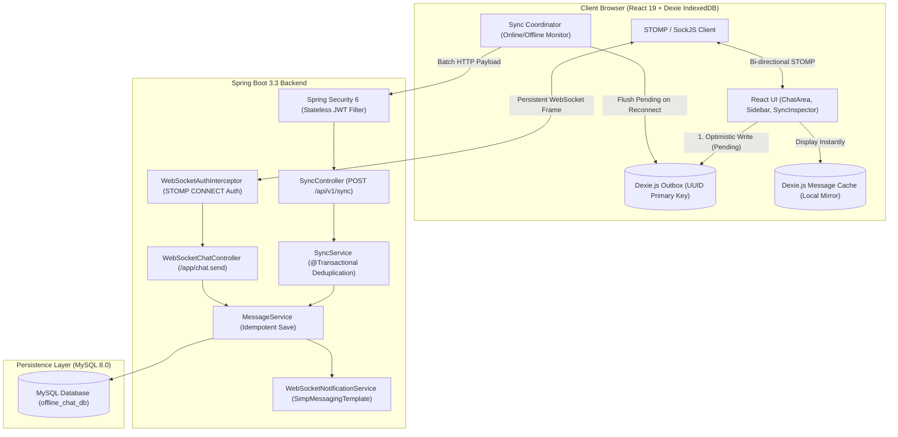

# PulseChat — Enterprise Offline-First Real-Time Chat Platform

[](https://openjdk.org/)
[](https://spring.io/projects/spring-boot)
[](https://spring.io/projects/spring-security)
[](https://stomp.github.io/)
[](https://react.dev/)
[](https://dexie.org/)
[](https://www.mysql.com/)
[-success.svg?style=flat-square)]()
[]()

PulseChat is a full-stack, **offline-first distributed messaging platform** engineered with **Java 21, Spring Boot 3.3, MySQL, STOMP WebSockets, React 19, and Dexie.js (IndexedDB)**.

Unlike naive chat applications that drop messages when internet connectivity fluctuates, PulseChat treats offline state as a first-class citizen. It implements an **IndexedDB Outbox Pattern** on the frontend paired with an **Idempotent Batch Synchronization Engine** on the backend, ensuring zero message loss and zero duplicate records across unstable networks and reconnect storms.

---

## 📑 Table of Contents
1. [Key Features & Capabilities](#1-key-features--capabilities)
2. [System Architecture & Data Flow](#2-system-architecture--data-flow)
3. [Key Engineering Patterns & Fault Tolerance](#3-key-engineering-patterns--fault-tolerance)
4. [Technology Stack](#4-technology-stack)
5. [Database Schema & ER Model](#5-database-schema--er-model)
6. [API Specifications & WebSocket Protocol](#6-api-specifications--websocket-protocol)
7. [Offline Queuing & Real-Time Verification](#7-offline-queuing--real-time-verification)
8. [Automated Testing Suite](#8-automated-testing-suite)
9. [Quick Start & Deployment Guide](#9-quick-start--deployment-guide)
10. [License](#10-license)

---

## 1. Key Features & Capabilities

- **Zero-Loss Offline Message Queuing:** Outgoing messages composed without an active internet connection are persisted in the browser's IndexedDB and queued in an outbox.
- **Idempotent Batch Synchronization (`POST /api/v1/sync`):** Client-generated UUIDs (`clientMessageId`) and database-level unique constraints eliminate 100% of duplicate message insertions during automated retries.
- **Bi-Directional Delta Reconciliation:** Upon reconnection, the client automatically synchronizes pending outbox records while simultaneously querying and fetching all missed incoming messages since `lastSyncTimestamp`.
- **Low-Latency Real-Time Messaging:** Bidirectional pub/sub communication over STOMP WebSockets with SockJS fallback and destination routing.
- **Token-Authenticated WebSocket Upgrades:** Inbound STOMP `CONNECT` frame interception validates JWT claims and binds authenticated security principals to the live socket session.
- **Reactive Optimistic UI:** Messages display immediately with a `🕒 PENDING` status, updating to `✓ SENT` and `✓✓ DELIVERED` as server acknowledgements return.
- **Built-in Storage Inspector:** An interactive diagnostics panel to monitor local Dexie IndexedDB tables (`outbox`, `messages`, `conversations`) and synchronization metrics in real time.

---

## 2. System Architecture & Data Flow

### 2.1 High-Level Component Architecture



### 2.2 Offline-to-Online Synchronization Sequence

```mermaid
sequenceDiagram
    autonumber
    actor User as Client (Alice)
    participant IDB as Local IndexedDB
    participant Net as Network Monitor
    participant Sync as SyncService (Frontend)
    participant Server as Spring Boot Backend
    participant DB as MySQL Database
    actor Bob as Recipient (Bob)

    Note over User,IDB: Connection Interrupted (Offline)
    User->>IDB: Send Message ("Hello Bob")
    IDB-->>User: Enqueue in Outbox (UUID, status: PENDING)
    User-->>User: Optimistic UI displays Pending Clock Icon

    Note over Net,Server: Connection Restored (online event fired)
    Net->>Sync: Trigger automatic synchronization
    Sync->>IDB: getPendingOutboxMessages() + getLastSyncTimestamp()
    IDB-->>Sync: Return queued messages and checkpoint T0

    Sync->>Server: POST /api/v1/sync (pendingMessages, lastSyncTimestamp)
    
    rect rgb(20, 30, 50)
        Note over Server,DB: Backend Transactional Processing
        Server->>DB: Check if client_message_id exists
        alt Message does not exist (New)
            Server->>DB: INSERT INTO messages
            Server->>DB: Update conversation preview and timestamp
            Server->>Bob: Push via STOMP /user/bob/queue/messages
        else Message already exists (Duplicate retry)
            Server-->>Server: Increment duplicatesSkipped, fetch existing ID
        end
        Server->>DB: Query missed incoming messages since T0
        DB-->>Server: Return messages from other participants
    end

    Server-->>Sync: Return SyncResponse (Acknowledged IDs, Missed Messages)
    Sync->>IDB: Mark message SENT, update serverId, remove from outbox
    Sync->>IDB: Update lastSyncTimestamp = now()
    Sync-->>User: UI updates status: PENDING to SENT
```



---

## 3. Key Engineering Patterns & Fault Tolerance

| Architecture Requirement | Traditional Approach | PulseChat Enterprise Implementation |
|---|---|---|
| **Message loss during network drops** | Immediate network request; fails and drops user input on timeout. | **Transactional Outbox Pattern:** Messages are committed to Dexie IndexedDB with status `PENDING` *before* attempting network transport. |
| **Duplicate messages on retry/reconnect** | Auto-increment IDs on the backend create duplicate rows if a client retries after a timeout. | **Client-Generated UUID Idempotency:** Client stamps `clientMessageId = crypto.randomUUID()`. Database enforces `UNIQUE(client_message_id)`. Retries safely return existing records. |
| **WebSocket Authentication** | Standard browser WebSocket APIs disallow custom HTTP Authorization headers during initial handshake. | **STOMP Frame Interception:** A custom `ChannelInterceptor` extracts the JWT bearer token from the STOMP `CONNECT` frame and establishes the authenticated `Principal`. |
| **Missed messages while offline** | Disconnected users miss all messages broadcast while offline. | **Bi-Directional Timestamp Checkpointing:** The sync request sends `lastSyncTimestamp`. The server delivers missed messages across all joined conversations since that timestamp. |
| **Non-blocking storage operations** | Synchronous `localStorage` blocks the main browser UI thread and is capped at ~5MB. | **Asynchronous IndexedDB:** Dexie.js provides non-blocking, transaction-safe storage supporting large message histories and atomic outbox mutations. |

---

## 4. Technology Stack

### Backend
- **Core Framework:** Java 21 LTS, Spring Boot 3.3.4
- **Security:** Spring Security 6 with JJWT 0.12.6 (Stateless Token Authentication, BCrypt password hashing)
- **Real-Time Messaging:** Spring WebSocket with STOMP broker and SockJS fallback
- **Data Access:** Spring Data JPA, Hibernate ORM 6.5, HikariCP connection pooling
- **Databases:** MySQL 8.0 (Production) & H2 Database (In-Memory / File-based for fast local runs and tests)
- **API Documentation:** SpringDoc OpenAPI 2.6 (Swagger UI 3.0)
- **Testing:** JUnit 5, Mockito, Spring Boot Test, AssertJ

### Frontend
- **Framework & Tooling:** React 19, Vite 8, React Router v7
- **Offline Storage:** Dexie.js 4.4 (IndexedDB wrapper with ACID transactions)
- **Real-Time Client:** `@stomp/stompjs` 7.5 & `sockjs-client` 1.6
- **HTTP Client:** Axios with JWT request injection and 401 response interceptors
- **Styling:** Custom Vanilla CSS design system (Dark obsidian palette, glassmorphism, responsive layout)

---

## 5. Database Schema & ER Model

```
+-----------------------------------------------------------+
|                          USERS                            |
+-----------------------------------------------------------+
| id            : BIGINT PK AUTO_INCREMENT                  |
| username      : VARCHAR(50)  UNIQUE NOT NULL              |
| email         : VARCHAR(100) UNIQUE NOT NULL              |
| password_hash : VARCHAR(255) NOT NULL (BCrypt)            |
| display_name  : VARCHAR(100) NOT NULL                     |
| avatar_url    : VARCHAR(255)                              |
| created_at    : TIMESTAMP DEFAULT CURRENT_TIMESTAMP       |
| updated_at    : TIMESTAMP DEFAULT CURRENT_TIMESTAMP       |
+-----------------------------------------------------------+
                             | 1
                             |
                             | M
+-----------------------------------------------------------+
|               CONVERSATION_PARTICIPANTS                   |
+-----------------------------------------------------------+
| id              : BIGINT PK AUTO_INCREMENT                |
| conversation_id : BIGINT FK -> CONVERSATIONS(id)          |
| user_id         : BIGINT FK -> USERS(id)                  |
| last_read_at    : TIMESTAMP                               |
| joined_at       : TIMESTAMP DEFAULT CURRENT_TIMESTAMP     |
+-----------------------------------------------------------+
                             M |
                               | 1
+-----------------------------------------------------------+
|                      CONVERSATIONS                        |
+-----------------------------------------------------------+
| id                   : BIGINT PK AUTO_INCREMENT           |
| type                 : VARCHAR(20) DEFAULT 'DIRECT'       |
| last_message_preview : TEXT                               |
| last_message_at      : TIMESTAMP                          |
| created_at           : TIMESTAMP DEFAULT CURRENT_TIMESTAMP|
+-----------------------------------------------------------+
                             | 1
                             |
                             | M
+-----------------------------------------------------------+
|                         MESSAGES                          |
+-----------------------------------------------------------+
| id                 : BIGINT PK AUTO_INCREMENT             |
| client_message_id  : VARCHAR(36) UNIQUE NOT NULL (UUID)   | <--- Idempotency Key
| conversation_id    : BIGINT FK -> CONVERSATIONS(id)       |
| sender_id          : BIGINT FK -> USERS(id)               |
| content            : TEXT NOT NULL                        |
| status             : VARCHAR(20) DEFAULT 'SENT'           |
| client_created_at  : TIMESTAMP NOT NULL                   |
| server_received_at : TIMESTAMP DEFAULT CURRENT_TIMESTAMP  |
+-----------------------------------------------------------+
```

### Indexing Strategy
- `idx_users_username` on `users(username)` — Accelerated user discovery and login queries.
- `idx_users_email` on `users(email)` — Fast email uniqueness validation.
- `idx_messages_client_id` on `messages(client_message_id)` — Instant $O(1)$ deduplication check during batch synchronization.
- `idx_messages_conv_server_time` on `messages(conversation_id, server_received_at)` — Optimized paginated history and delta reconciliation.

---

## 6. API Specifications & WebSocket Protocol

### 6.1 REST Endpoints

All authenticated endpoints require the header: `Authorization: Bearer <jwt-token>`.

#### Authentication (`/api/v1/auth`)
| Method | Endpoint | Request Body | Description |
|---|---|---|---|
| `POST` | `/api/v1/auth/register` | `{ username, email, password, displayName }` | Registers user, returns JWT and user profile |
| `POST` | `/api/v1/auth/login` | `{ usernameOrEmail, password }` | Authenticates credentials, returns JWT |
| `GET` | `/api/v1/auth/me` | *None* | Returns authenticated user profile |

#### Offline Synchronization (`/api/v1/sync`)
| Method | Endpoint | Request Body | Response Body |
|---|---|---|---|
| `POST` | `/api/v1/sync` | `SyncRequest` | `SyncResponse` |

**Sample `SyncRequest`:**
```json
{
  "pendingMessages": [
    {
      "clientMessageId": "8f2a1b94-5c3e-4d2a-b011-8e7c5d4f3a12",
      "conversationId": 10,
      "content": "Message composed during connection drop",
      "clientCreatedAt": "2026-10-22T14:30:00Z"
    }
  ],
  "lastSyncTimestamp": "2026-10-22T14:00:00Z"
}
```

**Sample `SyncResponse`:**
```json
{
  "acknowledgedMessages": {
    "8f2a1b94-5c3e-4d2a-b011-8e7c5d4f3a12": 104
  },
  "newIncomingMessages": [
    {
      "id": 105,
      "clientMessageId": "srv-105",
      "conversationId": 10,
      "sender": { "id": 2, "username": "bob", "displayName": "Bob" },
      "content": "Hey Alice, are you back online?",
      "status": "SENT",
      "serverReceivedAt": "2026-10-22T14:25:00Z"
    }
  ],
  "duplicatesSkipped": 0
}
```

#### Conversations & Messaging (`/api/v1/conversations`)
| Method | Endpoint | Description |
|---|---|---|
| `GET` | `/api/v1/conversations` | Lists conversations with other participants and unread counts |
| `POST` | `/api/v1/conversations/direct` | Finds existing or creates new direct conversation with recipient |
| `GET` | `/api/v1/conversations/{id}/messages` | Paginated message history (`?page=0&size=50`) |
| `POST` | `/api/v1/conversations/{id}/messages` | REST fallback for sending messages |
| `POST` | `/api/v1/conversations/{id}/read` | Updates participant's `lastReadAt` timestamp |

---

### 6.2 STOMP WebSocket Protocol

- **Endpoint:** `http://localhost:8080/ws` (with SockJS handshake fallback)
- **STOMP Connect Header:** `Authorization: Bearer <jwt-token>`

| Destination | Direction | Payload Schema | Description |
|---|---|---|---|
| `/app/chat.send/{conversationId}` | Client ➔ Server | `{ clientMessageId, content, clientCreatedAt }` | Sends message to conversation participants |
| `/user/queue/messages` | Server ➔ Client | `MessageResponse` JSON | Personal queue for incoming direct messages |
| `/user/queue/receipts` | Server ➔ Client | `{ clientMessageId, status }` | Delivery & read receipt updates |

---

## 7. Offline Queuing & Real-Time Verification

PulseChat includes a built-in **Simulation & Diagnostics Engine** to verify offline durability and synchronization workflows:

1. **Multi-User Real-Time Communication:**
   - Open `http://localhost:5173` in two browser windows side-by-side.
   - Use the **1-Click Demo Accounts**: Sign in as **👩 Alice** in Window 1 and **👨 Bob** in Window 2.
   - Open a direct conversation and exchange messages to verify sub-second WebSocket transmission with `✓✓ Delivered` receipt indicators.

2. **Simulating Connection Disruption:**
   - In Alice's window, click **⚡ Simulate Offline** in the navigation header.
   - The status indicator switches to `Offline (Simulated)` and severs the active WebSocket session.
   - Compose and send a message.
   - The message bubble renders optimistically with a **`🕒 Pending`** status icon.
   - Click **💾 Storage** in the navigation bar to inspect the Dexie IndexedDB `outbox` table and verify the pending record and generated UUID.

3. **Automatic Reconnection & Batch Sync:**
   - Click **⚡ Simulating Offline** to reconnect.
   - The sync manager automatically triggers `POST /api/v1/sync`.
   - The status transitions to **`✓ Sent`**, the local outbox clears, and the message is delivered to Bob's window in real time.
   - Subsequent sync triggers demonstrate database idempotency (`0 duplicates inserted`).

---

## 8. Automated Testing Suite

PulseChat maintains an automated test suite verifying business layer transactions, authentication constraints, and deduplication logic:

```bash
cd backend
./mvnw test
```

### Test Coverage Breakdown
- **`BackendApplicationTests`**: Validates Spring ApplicationContext initialization, JPA repository bootstrapping, and Hibernate schema generation.
- **`AuthServiceTest`**: Validates user registration, BCrypt password hashing, uniqueness constraints, and JWT generation.
- **`MessageServiceTest`**: Asserts that repeating a `clientMessageId` returns the existing record idempotently without database duplicate writes.
- **`SyncServiceTest`**: Simulates batch outbox synchronization, acknowledgement mapping, and duplicate skip tracking (`duplicatesSkipped`).

```text
[INFO] Running com.offlinechat.BackendApplicationTests
[INFO] Tests run: 1, Failures: 0, Errors: 0, Skipped: 0
[INFO] Running com.offlinechat.service.AuthServiceTest
[INFO] Tests run: 4, Failures: 0, Errors: 0, Skipped: 0
[INFO] Running com.offlinechat.service.MessageServiceTest
[INFO] Tests run: 2, Failures: 0, Errors: 0, Skipped: 0
[INFO] Running com.offlinechat.service.SyncServiceTest
[INFO] Tests run: 2, Failures: 0, Errors: 0, Skipped: 0
[INFO] ------------------------------------------------------------------------
[INFO] BUILD SUCCESS (9 tests executed, 0 failures, 0 errors)
[INFO] ------------------------------------------------------------------------
```

---

## 9. Quick Start & Deployment Guide

### Prerequisites
- **Java 21 JDK**
- **Node.js 18+** & **npm**
- **Docker & Docker Compose** (optional; local mode runs with persistent file-based H2 database)

### Option A: Run with Docker Compose (MySQL 8.0)
```bash
# 1. Start MySQL container
docker compose up -d

# 2. Run backend
cd backend
./mvnw spring-boot:run
```

### Option B: Zero-Config Local Run (Embedded Persistence)
```bash
# Run backend directly (uses persistent file database in ./data/chatdb)
cd backend
./mvnw spring-boot:run
```
- API Base URL: `http://localhost:8080`
- Swagger UI Documentation: `http://localhost:8080/swagger-ui.html`
- OpenAPI Specification: `http://localhost:8080/api-docs`

### Frontend Launch
```bash
cd frontend
npm install
npm run dev
```
- Access the web interface at: `http://localhost:5173`

---

## 10. License

This project is open-source software licensed under the [MIT License](LICENSE).
